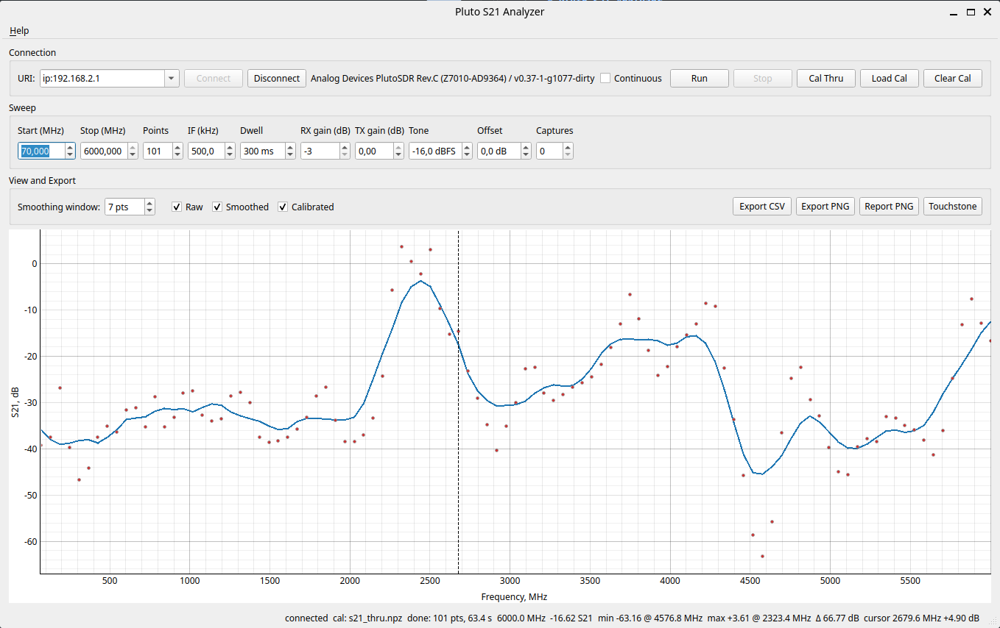
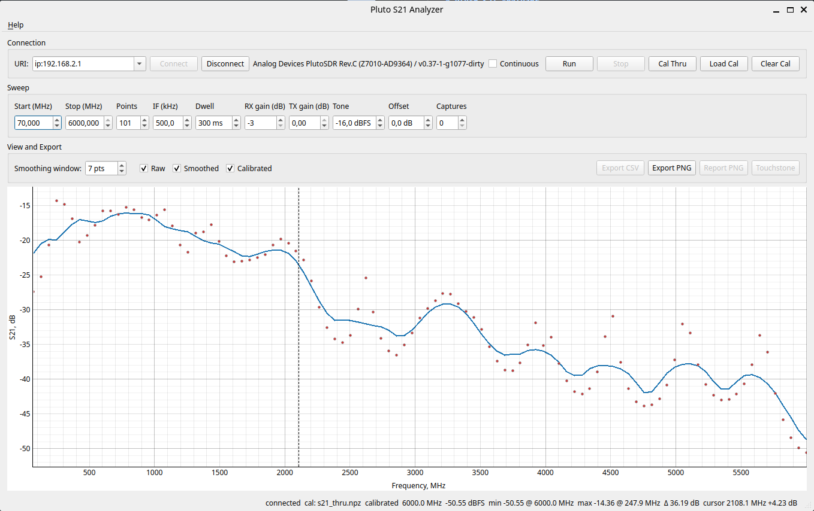

# Pluto S21 Analyzer

[](https://github.com/ra4hgn/pluto-analyzer/actions/workflows/tests.yml)
[](LICENSE)
[](https://www.python.org/downloads/)

Scalar S21 measurement (magnitude only) with **ADALM-PLUTO Rev.B (AD9363)**
over **70–6000 MHz**. The board runs a range-extended firmware (reported as a
1×1 device); only one RX/TX path is wired, so no phase, S11 or S12/S22.

Status: **complete** — CLI and GUI, thru calibration, report PNG/PDF and
optional Touchstone export. Hardware: calibrated thru −0.02 dB mean (std
0.30 dB) over 70–6000 MHz.
Manuals: [measurement guide](src/pluto_analyzer/help/measurement.md),
[calibration guide](src/pluto_analyzer/help/calibration.md). Both are also
available from the GUI **Help** menu (F1 opens the measurement guide).
Design and measurement notes: [docs/design.md](docs/design.md).



## Hardware

- PlutoSDR Rev.B on AD9363, firmware v0.38-dirty with the range extension.
- One RX / one TX: measurement path is `TX1 → DUT → RX1`.
- Host: Ubuntu 26.04, Python 3.14, libiio 0.26.
- URI: `ip:192.168.2.1` (shared) or `usb:3.3.5` (exclusive).

## Installation

Requirements:

- Python 3.10 or newer;
- the libiio shared library (`libiio0`/`libiio-dev` on Debian/Ubuntu) — the
  `pylibiio` package is only a binding and needs it at import time;
- an ADALM-PLUTO reachable over USB or network.

```bash
git clone https://github.com/ra4hgn/pluto-analyzer.git
cd pluto-analyzer
python3 -m venv .venv
source .venv/bin/activate
python -m pip install --upgrade pip
pip install -e .
```

The package installs two entry points: `pluto-na` (GUI) and `pluto-na-cli`
(command line). All examples below assume the virtual environment is active.

If numpy/scipy/PyQt6 are already installed system-wide (PEP 668 hosts), create
the environment with `--system-site-packages`; `requirements.txt` pins the
Python bindings that match libiio 0.26:

```bash
python3 -m venv --system-site-packages .venv
source .venv/bin/activate
pip install -r requirements.txt
pip install -e . --no-deps
```

## Command line

```bash
# capabilities and span validation
pluto-na-cli info
pluto-na-cli info --uri usb:3.3.5

# one sweep, 70..6000 MHz, 500 points -> results/<timestamp>/trace.csv + meta.json
pluto-na-cli measure
pluto-na-cli measure --start 70 --stop 6000 --points 500 \
    --dwell-ms 100 --out results/run1
pluto-na-cli measure --points 1 --start 900 --stop 900   # single point
```

Useful options: `--if-khz`, `--fs-mhz`, `--samples`, `--captures`,
`--tx-gain`, `--rx-gain`, `--json`, `--quiet`, `--uri`.

### Shared Pluto and the busy check

The board is shared. Before a sweep the tool watches DDS/LO/rate/gain for
~1 s (`PlutoVNA.check_quiet`). If another client changes them, `measure` stops
with exit code 4 and prints what changed:

```
ERROR: the Pluto is being reconfigured by another client (changed: dds_enabled).
Free the device or use --allow-busy to measure anyway.
```

`--allow-busy` overrides the check (the trace is then marked as suspect).
Free the device (stop other streams/tools) before a real measurement.

Output:

- `trace.csv` — `freq_hz, lo_hz, tone_hz, captures, amplitude, dbfs, peak,
  clip, low` (no calibration applied yet, so values are dBFS).
- `meta.json` — app version, URI, full `SweepConfig`, hardware capabilities,
  warnings and summary (min/max/mean, CLIP/LOW counts, duration).
- `CLIP` is derived from the ADC peak and may fire on a transient even when the
  lock-in tone is weak; `LOW` means |signal| < −90 dBFS.

## Calibration

```bash
# reference sweep with the fixture (cables + 10 dB attenuator) in place
pluto-na-cli cal --points 21 --start 70 --stop 6000 --out cal/s21_thru

# calibrated measurement: trace.csv gets an s21_db column
pluto-na-cli measure --cal cal/s21_thru --points 21 \
    --start 70 --stop 6000 --out results/run1
```

Accepted result: calibrated thru reads 0.00 ± 0.65 dB over 70 MHz–6 GHz
(std 0.30 dB), a 10 dB gain-step check gives −10 ± 0.4 dB.



`Offset (dB)` / `--offset-db` adds a constant to the calibrated S21. Use it when
the reference path contains a known pad: calibrate with a 10 dB pad, then set
`Offset = -10` to display a 30 dB DUT as −30 dB (measured difference −20 dB).
Keep Tone/RX/TX gains identical between calibration and measurement.

## Reports and Touchstone export

```bash
pluto-na-cli measure --cal cal/s21_thru --points 101 \
    --start 70 --stop 6000 --out results/run1 \
    --png results/run1/report.png \
    --pdf results/run1/report.pdf \
    --touchstone results/run1/trace.s2p
```

- report PNG/PDF: matplotlib, title, min/max annotations, footer with points,
  calibration flag, URI and UTC date;
- Touchstone `.s2p`: measured |S21| in `[DB]`, phase written as 0°, S11/S12/S22
  are −100 dB placeholders, header warnings. **Magnitude only — not for
  phase-sensitive analysis.**

In the GUI the same is available via **Report PNG** and **Touchstone** buttons.

## GUI

```bash
pluto-na
```

English interface, PyQt6 + pyqtgraph:

- URI selector: `ip:192.168.2.1`, `usb:`, custom; Connect/Disconnect;
- sweep fields: start/stop MHz, points, IF, dwell, RX/TX gain, captures;
- Run / Stop / Continuous, progress and per-point status with CLIP/LOW/UNSTABLE;
- live curve plus raw points, Raw/Smoothed/Calibrated toggles; the smoothing
  window (moving average over frequency points, default 7) is in the
  **View and Export** row and is disabled when Smoothed is off — it only
  affects the displayed curve, exports use raw data;
- markers: left click adds a marker (MHz / dB), right click clears all;
- cursor readout, min/max/Δ in the status bar;
- Cal Thru / Load Cal / Clear Cal (calibration is applied automatically);
- Export CSV (+ JSON meta) and Export PNG;
- **Help** menu with the measurement and calibration guides (F1 opens the
  measurement guide) and an About dialog.

The SDR is owned by a worker thread (`gui/worker.py`); the GUI never touches
IIO directly. Closing the window stops the sweep and restores the Pluto.

## Standalone scripts

Environment and dependency check:

```bash
python scripts/check_env.py
python scripts/check_env.py --uri ip:192.168.2.1
```

Hardware capabilities and span validation:

```bash
python -m pluto_analyzer.hwcheck --uri ip:192.168.2.1
```

Loopback test (connect `TX → attenuator → RX`), raw dBFS, no calibration:

```bash
python scripts/loopback_test.py \
    --uri ip:192.168.2.1 \
    --freqs 70,100,433,900,1300,2400,3500,5800,6000 \
    --csv results/loopback.csv
```

Options: `--if-khz 500`, `--fs-mhz 8`, `--samples 262144`, `--captures N`,
`--tx-gain -10`, `--rx-gain 50`, `--dwell-ms 100`, `--json`.

## Measurement notes

- CW tone at IF = 500 kHz, complex TX buffer, cyclic.
- LO = f − IF (auto reverse-IF at the 70 MHz lower edge), detection at the
  signed IF; the probed RF frequency stays exactly on the grid.
- Lock-in: mix, block decimation by `fs/|IF|` (sinc nulls at IF multiples),
  Hann-windowed coherent averaging.
- Flags per point: `CLIP` (ADC peak ≥ 0.8 FS) and `LOW` (|S21| below −90 dBFS).
- Only |S21| is measured; Touchstone export will be optional and marked.
- Working defaults: `tx_gain=0` (the Pluto TX attenuator has one usable step;
  intermediate values make the TX path unstable), `rx_gain=10` for a
  `TX → 10 dB attenuator → RX` loopback, dwell 300 ms, 3/2 captures below/above
  1 GHz with median combining, `tone_settle=300 ms` after buffer reload.
- The Pluto's AD9361 gain table ends at 4 GHz (`gaintable ... end=4000000000`),
  so the reference level has a step of several dB around 4.04 GHz. Calibrate
  with the same or denser grid than the measurement; a 21-point calibration
  cannot resolve this step and produces spikes near 4 GHz. AD9363 is only
  specified up to 3.8 GHz anyway.

## Implementation notes

- Use `adi.Pluto` (or `adi.ad9364`), **not** `adi.ad9361`: the latter expects
  two RX channels and fails with `Channel voltage2 not found` on this 1×1 board.
- Writing `sample_rate` through pyadi enables the AD9361 FIR filter
  (`filter_fir_en=1`, rate range 0.52–30.72 MSPS). The loopback script reads the
  device state before configuring it and restores it afterwards (sample rate,
  gains, bandwidths, LOs and the FIR enable flag), so the shared Pluto is left
  as it was found.
- Fixed defaults that reproduce the factory idle state: 30.72 MSPS, FIR off,
  `slow_attack`, LO 5.76 GHz, RF BW 18 MHz.

## Troubleshooting

### GNOME: `GLib-GIO-ERROR ... does not contain a key named 'antialiasing'`

Qt 6 auto-selects the GTK3 platform theme on GNOME; the plugin reads
`org.gnome.settings-daemon.plugins.xsettings antialiasing`, which recent GNOME
releases removed, and GLib aborts the process. `pluto-na` now detects this
(probes `gsettings`) and drops the GNOME desktop hints before creating
`QApplication`, so Qt uses its built-in theme.

- `PLUTO_NA_KEEP_THEME=1 pluto-na` keeps the system theme if your
  schema is fixed.
- For a native-looking theme install `qt6ct` and run with
  `QT_QPA_PLATFORMTHEME=qt6ct PLUTO_NA_KEEP_THEME=1 pluto-na`.
- Alternatively remove the broken plugin package (`qt6-gtk-platformtheme`).

## Project layout

```
src/pluto_analyzer/   package: SDR wrapper, DSP, sweep engine, calibration,
                      export, CLI and the PyQt6 GUI
scripts/              standalone hardware/environment checks and helpers
tests/                hardware-independent unit tests (unittest)
docs/design.md        methodology, hardware constraints and limitations
docs/*.png            example report and calibration plots
src/pluto_analyzer/help/  measurement and calibration guides (shown in Help)
```

Generated data is not part of the repository: `cal/` holds calibration files
created by `pluto-na-cli cal`, `results/` holds sweeps and reports.

## Tests

The unit tests do not need a PlutoSDR attached:

```bash
python -m unittest discover -s tests -v
```

## License

Released under the [MIT License](LICENSE). The measurement concept is based on
[fromconcepttocircuit/pluto-network-analyzer](https://github.com/fromconcepttocircuit/pluto-network-analyzer)
(MIT); this project is an independent scalar-S21 implementation for a 1×1
AD9363 board.
